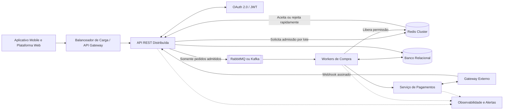
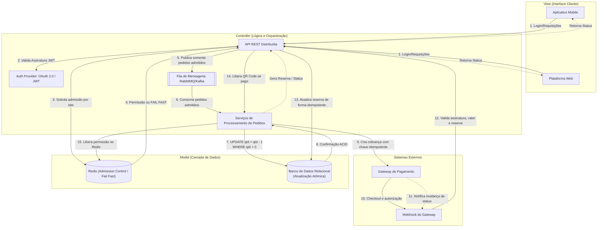
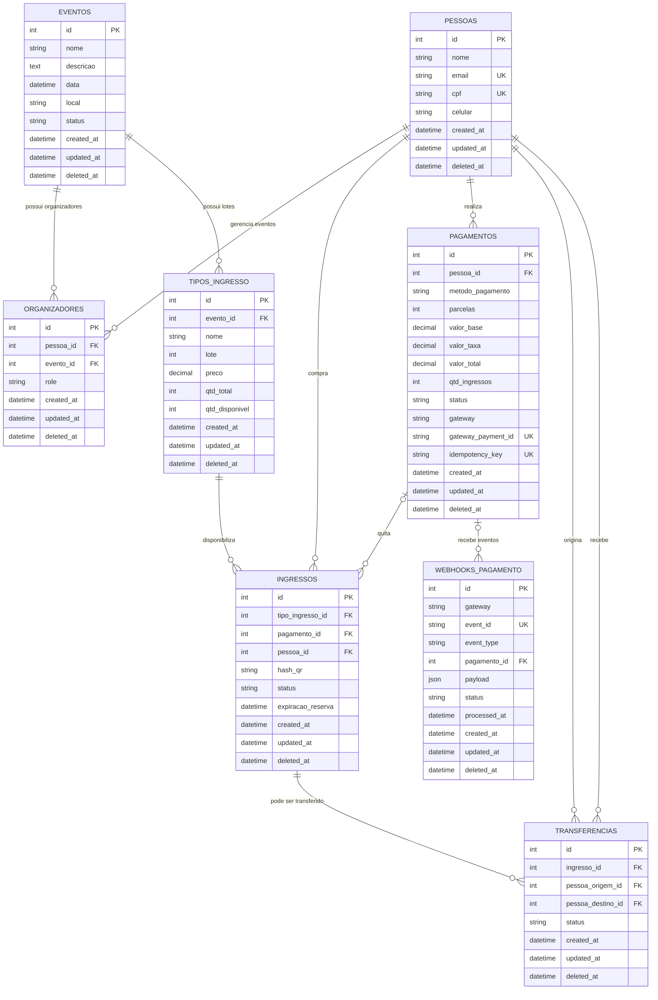

## Arquitetura macro

O diagrama macro mostra os principais limites do sistema e o caminho das dependências. Os clientes nunca acessam diretamente o banco, o Redis ou o gateway. Antes de publicar uma compra, a API consulta o Redis como um **admission controller** por lote: o Redis aceita apenas a quantidade configurada de pedidos em processamento e rejeita o excedente imediatamente. Só as requisições admitidas entram na fila e chegam aos workers, evitando formar uma fila de trabalho maior do que a capacidade segura do banco. O banco continua sendo a autoridade final do estoque; o Redis apenas controla pressão e não representa saldo de ingressos.

## Fluxo distribuído de compra

### Responsabilidade de cada etapa

1. **Cliente -> API:** o aplicativo ou a plataforma web envia evento, lote, quantidade e chave idempotente. A API valida o JWT, os parâmetros, o preço vigente e a permissão do comprador.
2. **API -> Auth Provider:** a API valida assinatura, expiração e escopos do JWT. Token inválido deve ser rejeitado antes de consultar o Redis ou publicar qualquer pedido.
3. **API -> Redis:** a API solicita uma permissão de admissão para o `tipo_ingresso_id`. O Redis mantém um contador ou semáforo com limite de requisições em processamento e TTL para evitar permissões presas.
4. **Redis -> API:** se houver capacidade, o Redis confirma a permissão; se o limite estiver atingido ou o Redis estiver indisponível, a API falha rapidamente com `429` ou `503`, sem publicar na fila e sem acessar o banco.
5. **API -> Fila:** somente depois da admissão confirmada a API registra a intenção pela chave idempotente e publica uma mensagem durável. Se a publicação falhar, a permissão deve ser devolvida ao Redis.
6. **Fila -> Worker:** o worker consome apenas pedidos que já passaram pelo controle de pressão. A mensagem só deve ser confirmada depois da reserva e da criação ou reconhecimento da cobrança.
7. **Worker -> Banco:** o worker executa a atualização condicional `qtd_disponivel = qtd_disponivel - 1 WHERE qtd_disponivel > 0` dentro de uma transação. O Redis não informa nem substitui o saldo real.
8. **Banco -> Worker:** uma linha atualizada confirma a baixa; nenhuma linha atualizada significa lote esgotado. O worker cria a reserva `RESERVADO` com prazo de expiração na mesma transação ou em uma transação claramente compensável.
9. **Worker -> Gateway:** o serviço de pagamentos cria a cobrança usando `idempotency_key`, valor calculado no servidor e referência da reserva. Dados completos do cartão permanecem no provedor.
10. **Gateway -> Checkout:** o gateway processa PIX, débito, crédito ou outro meio suportado. Criar a cobrança significa apenas `PENDENTE`, nunca pagamento aprovado.
11. **Gateway -> Webhook:** o gateway envia um evento assinado com `event_id`, status, valor e identificador externo. Reenvios e eventos fora de ordem devem ser esperados.
12. **Webhook -> API:** a API valida assinatura, gateway, `event_id`, valor, `gateway_payment_id` e vínculo com o pagamento. O evento é persistido em `WebhooksPagamento` para idempotência e reconciliação.
13. **API -> Banco:** em uma transação, a API altera pagamento e ingresso apenas se o estado atual permitir a transição. Evento repetido não cria ingresso nem devolve estoque novamente.
14. **API -> Worker:** pagamento aprovado libera o QR Code; falha, cancelamento ou expiração marca o ingresso como `CANCELADO` e devolve a unidade ao lote uma única vez.
15. **Worker -> Redis:** após finalizar o processamento, inclusive em erro, o worker libera a permissão em um bloco `finally`. O TTL permanece como proteção contra queda do processo.
16. **API -> Cliente:** a API retorna o estado por consulta, polling ou notificação. O cliente só exibe o QR Code quando o estado persistido for `PAGO`.

O Redis atua como **fail fast**, não como lock de estoque: ele limita a pressão sobre o banco antes da fila e do worker, mas não garante disponibilidade nem consistência da cota. A proteção definitiva contra *double selling* é a atualização condicional e transacional do banco. O limite do Redis deve ser configurado abaixo da capacidade sustentada do banco, monitorado e ajustado com métricas de latência, rejeições e ocupação.

## Modelo de banco de dados

O diagrama abaixo representa as entidades implementadas no backend e seus relacionamentos. As chaves estrangeiras estão indicadas nos campos `FK`; a cardinalidade considera o comportamento definido pelos relacionamentos SQLAlchemy.

### Regras representadas

- Um evento pode ter vários organizadores e vários tipos de ingresso; cada registro de `Organizador` vincula uma pessoa a um evento e define sua função.
- Cada ingresso pertence a um tipo de ingresso e a uma pessoa. O `pagamento_id` é opcional durante a reserva e fica associado quando a cobrança é criada ou confirmada.
- Um pagamento pertence a uma pessoa e pode quitar vários ingressos da mesma compra. Seus estados previstos são `PENDENTE`, `APROVADO`, `RECUSADO` e `ESTORNADO`.
- O ingresso controla `RESERVADO`, `PAGO`, `CANCELADO` e `UTILIZADO`, além do prazo de expiração e do QR Code.
- Uma transferência registra o ingresso, a pessoa de origem, a pessoa de destino e seu estado (`PENDENTE`, `CONCLUIDA` ou `CANCELADA`).

Os campos `gateway`, `gateway_payment_id` e `idempotency_key` em `Pagamentos`, junto com a tabela `WebhooksPagamento`, suportam a integração com o gateway externo. O `event_id` único permite registrar e ignorar reenvios do mesmo webhook, enquanto `processed_at` permite acompanhar a conciliação e o reprocessamento seguro.
