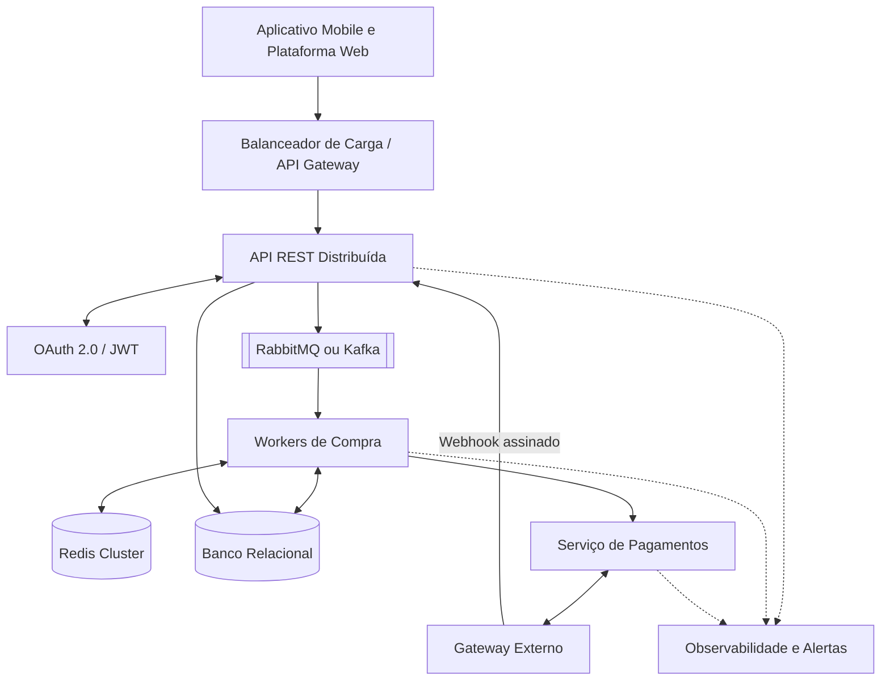
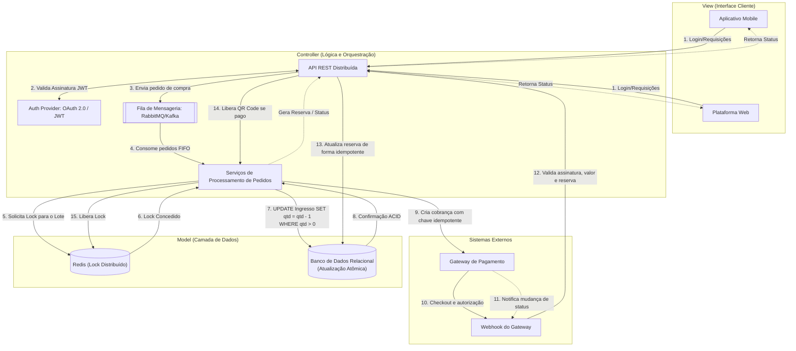
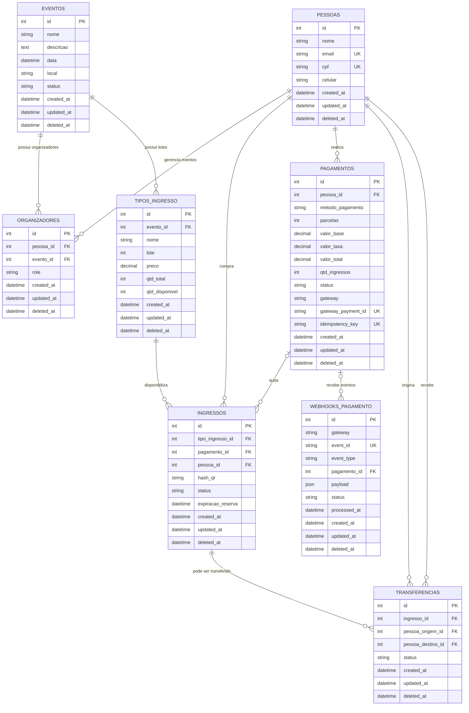

## Arquitetura macro

O diagrama macro mostra os principais limites do sistema e o caminho das dependências. Os clientes nunca acessam diretamente o banco, o Redis ou o gateway. O balanceador distribui as requisições entre instâncias da API; a fila absorve picos; os workers processam a reserva; e o serviço de pagamentos concentra a integração com o provedor externo. A observabilidade acompanha API, workers e pagamentos para permitir diagnóstico de filas, falhas e divergências de conciliação.

## Fluxo distribuído de compra

### Responsabilidade de cada etapa

1. **Cliente -> API:** o aplicativo ou a plataforma web envia evento, lote, quantidade e chave idempotente. A API valida o JWT, os parâmetros, o preço vigente e a permissão do comprador.
2. **API -> Auth Provider:** a API valida assinatura, expiração e escopos do JWT. Token inválido deve ser rejeitado antes de publicar qualquer pedido.
3. **API -> Fila:** a API registra ou reconhece a intenção de compra pela chave idempotente e publica uma mensagem durável. A resposta ao cliente informa que o pedido está em processamento.
4. **Fila -> Worker:** um worker consome a mensagem, confirma seu processamento somente depois de concluir a operação e pode reprocessá-la com segurança em caso de falha.
5. **Worker -> Redis:** o worker adquire um lock curto por `tipo_ingresso_id`, com TTL e identificação do proprietário. Se não obtiver o lock, deve aguardar ou reencaminhar o pedido sem alterar o estoque.
6. **Redis -> Worker:** com o lock confirmado, o worker executa a operação crítica. O lock deve ser liberado pelo mesmo proprietário e também expirar automaticamente em caso de queda.
7. **Worker -> Banco:** o worker executa uma atualização condicional, como `qtd_disponivel = qtd_disponivel - 1 WHERE qtd_disponivel > 0`, dentro de uma transação. Nenhuma linha atualizada significa lote esgotado.
8. **Banco -> Worker:** se a transação for confirmada, o worker cria o ingresso com estado `RESERVADO` e prazo de expiração. Se não houver saldo, faz rollback e informa indisponibilidade sem gerar cobrança.
9. **Worker -> Gateway:** o serviço de pagamentos cria a cobrança usando `idempotency_key`, valor calculado no servidor e referência da reserva. O PARTIU não recebe nem armazena dados completos do cartão.
10. **Gateway -> Checkout:** o gateway processa PIX, débito, crédito ou outro meio suportado. A criação da cobrança significa apenas `PENDENTE`, nunca pagamento aprovado.
11. **Gateway -> Webhook:** o gateway envia um evento assinado com `event_id`, status, valor e identificador externo. Reenvios são esperados e não devem causar efeitos duplicados.
12. **Webhook -> API:** a API valida assinatura, gateway, `event_id`, valor, `gateway_payment_id` e vínculo com o pagamento. O evento é persistido em `WebhooksPagamento` antes ou durante o processamento idempotente.
13. **API -> Banco:** em uma transação, a API altera o pagamento e o ingresso apenas se o estado atual permitir a transição. Evento repetido deve ser reconhecido sem criar ingresso ou devolver estoque novamente.
14. **API -> Worker:** pagamento aprovado libera o QR Code e informa o novo estado. Pagamento recusado, cancelado ou reserva expirada marca o ingresso como `CANCELADO` e devolve a unidade ao lote uma única vez.
15. **Worker -> Redis:** após persistir o resultado, o worker libera o lock. O TTL permanece como proteção contra processos que terminem inesperadamente.
16. **API -> Cliente:** a API retorna ou disponibiliza o estado por consulta/polling ou notificação. O cliente só deve exibir o QR Code quando o estado persistido for `PAGO`.

O gateway é um sistema externo e pode ficar indisponível ou responder fora de ordem. Por isso, a aplicação deve tratar reprocessamento, timeout, conciliação periódica e estados intermediários como `aguardando_pagamento`, em vez de considerar a criação da cobrança como pagamento confirmado.

## Modelo de banco de dados

O diagrama abaixo representa as entidades implementadas no backend e seus relacionamentos. As chaves estrangeiras estão indicadas nos campos `FK`; a cardinalidade considera o comportamento definido pelos relacionamentos SQLAlchemy.

### Regras representadas

- Um evento pode ter vários organizadores e vários tipos de ingresso; cada registro de `Organizador` vincula uma pessoa a um evento e define sua função.
- Cada ingresso pertence a um tipo de ingresso e a uma pessoa. O `pagamento_id` é opcional durante a reserva e fica associado quando a cobrança é criada ou confirmada.
- Um pagamento pertence a uma pessoa e pode quitar vários ingressos da mesma compra. Seus estados previstos são `PENDENTE`, `APROVADO`, `RECUSADO` e `ESTORNADO`.
- O ingresso controla `RESERVADO`, `PAGO`, `CANCELADO` e `UTILIZADO`, além do prazo de expiração e do QR Code.
- Uma transferência registra o ingresso, a pessoa de origem, a pessoa de destino e seu estado (`PENDENTE`, `CONCLUIDA` ou `CANCELADA`).

Os campos `gateway`, `gateway_payment_id` e `idempotency_key` em `Pagamentos`, junto com a tabela `WebhooksPagamento`, suportam a integração com o gateway externo. O `event_id` único permite registrar e ignorar reenvios do mesmo webhook, enquanto `processed_at` permite acompanhar a conciliação e o reprocessamento seguro.

## MER conceitual da integração de pagamentos

Este MER abstrai os detalhes físicos e destaca as novas entidades responsáveis pela comunicação com o gateway. `Pagamento` representa a cobrança no domínio do PARTIU; `WebhookPagamento` representa cada evento recebido do provedor; e `Ingresso` mantém a reserva que será confirmada ou cancelada. O vínculo opcional permite receber um webhook antes de localizar o pagamento, preservando o evento para reconciliação posterior.